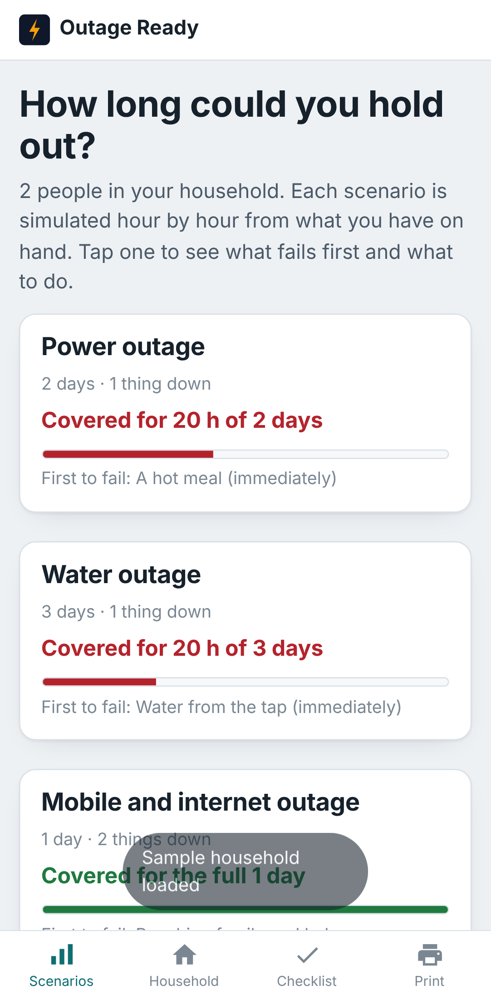
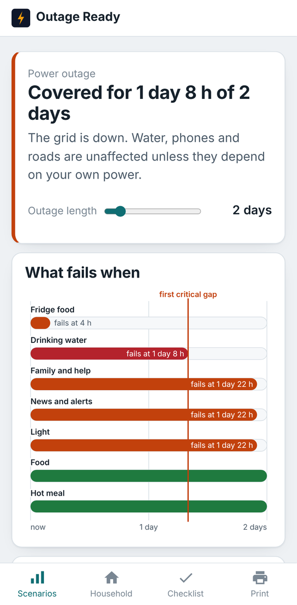
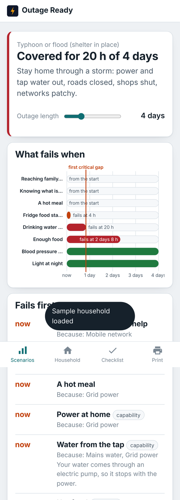
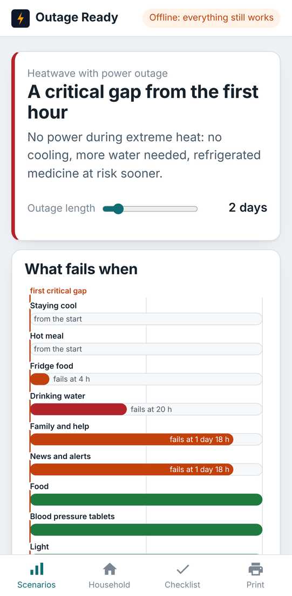
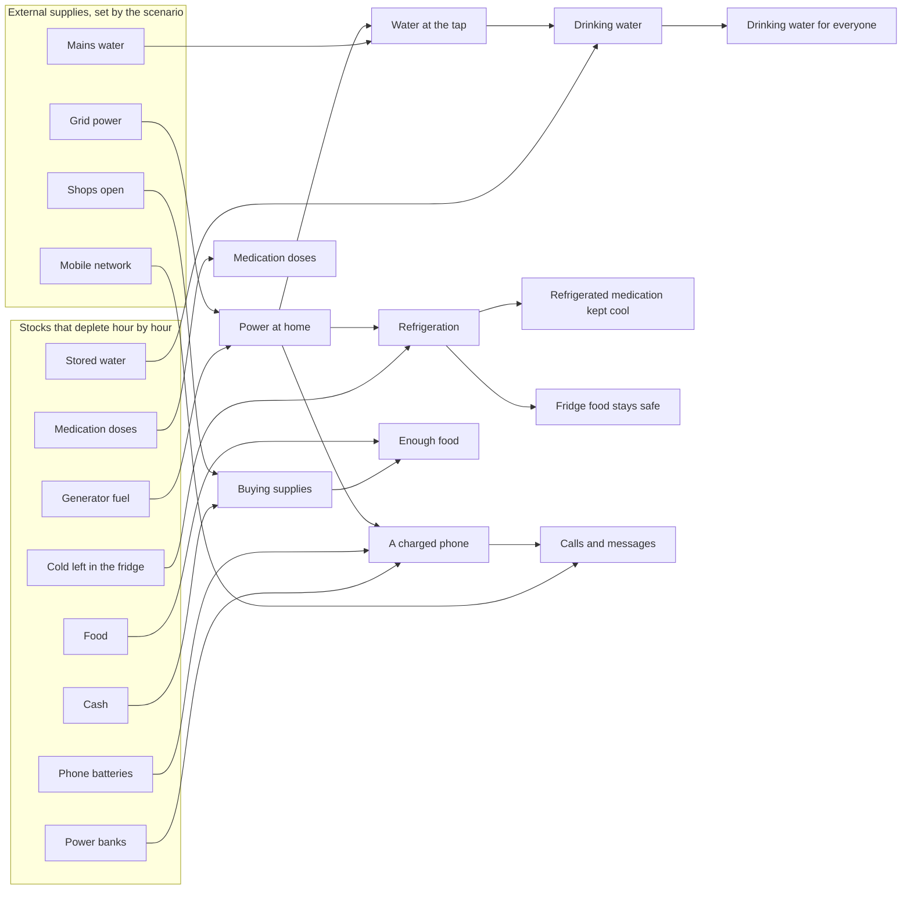

# Outage Ready

**What your household can sustain in an outage, what fails first, and what to do next.**

Most preparedness advice is a checklist. Outage Ready is a simulator. You
tell it what you actually have on hand (water, food, power banks, medication,
transport, contacts) and how your home works (pumped or gravity water,
electric or gas cooking, fridge and freezer). It then plays each outage
scenario forward hour by hour, following the dependencies in your home, and
tells you:

- how long you are covered, and which need breaks that cover first;
- a timeline of what fails when, and why (pump → power, fridge → power →
  medication, phone → power bank → network);
- a prioritised list of what to do now, before the next outage, and during it;
- a one-page printable backup plan.

It installs on Windows, macOS, iPhone and Android, works fully offline after
the first visit, and keeps every byte of data on your device.

**Live app:** https://kennethkimbrough.github.io/outage-ready/

<p>
  
  
  
  
</p>

Screenshots come from the Playwright suite, which also reloads the app with the
network disabled to confirm the service worker serves it.

## Why it is different

Supply trackers that report "days of readiness" exist (see
[docs/PRIOR_ART.md](docs/PRIOR_ART.md)). Outage Ready adds the thing they
leave out: the same inventory gives a different answer in a different home.
Twelve litres of water lasts a day and a half in a house on mains pressure
with the power out, and the same twelve litres is the only drinking water you
have from the first minute in an apartment with an electric pump. The engine
knows the difference because it models the chain, not the list.

## Scenarios

| Scenario | What is down | Default length |
|---|---|---|
| Power outage | grid power | 2 days |
| Water outage | mains water | 3 days |
| Mobile and internet outage | mobile network, internet | 1 day |
| Heatwave with power outage | grid power, plus extreme heat (water need doubles, cooling fails, insulin at risk) | 2 days |
| Typhoon or flood (shelter in place) | power, water, roads, shops, patchy network | 4 days |
| Evacuation | power, water, shops; vehicle, cash and contacts matter | 3 days |

Each length is adjustable with a slider from 6 hours to 2 weeks.

## How the engine works



1. **Graph.** `src/engine/graph.ts` builds a dependency graph for the
   specific household: supplies and stocks feed capabilities, capabilities
   serve needs. A home with an electric pump gets a `water-at-tap` node that
   requires power; a gravity-fed home does not. Each need has a severity from
   1 (comfort) to 5 (life safety).
2. **Simulation.** `src/engine/simulate.ts` steps through the scenario an
   hour at a time. Supplies are switched off by the scenario's hazards, stocks
   are consumed at rates taken from the assumptions (water per person per day,
   phone energy per day, stove hours per day), and the graph is re-evaluated
   each hour. The first hour a node is unavailable is its failure time, and
   the graph explains why. The cold chain is modelled explicitly: a closed
   fridge keeps 4 hours of cold, perishables are written off 4 hours after
   that, a freezer thaws at 24 or 48 hours depending on how full it is, and
   insulin gets a 28-day room-temperature window unless there is extreme heat.
3. **Prioritisation.** `src/engine/prioritize.ts` turns the result into tasks
   with a stable id, a phase (now / before / during), a severity, an effort
   and the hours to the failure it addresses. Score = severity × (1 + 48 /
   (hours + 1)) ÷ effort, so a life-safety gap that opens in four hours sorts
   above a comfort item that opens in four days. Task ids are stable, so
   ticking one off survives re-running the simulation.

The engine has no DOM dependency and is covered by 23 `node:test` cases
(`tests/`): graph evaluation, depletion arithmetic, cold-chain timing,
phone/power-bank energy, overrides, and task ordering.

## Assumptions and sources

Every number the simulation relies on is listed on the Assumptions screen with
its source, and can be edited. The defaults:

| Assumption | Value | Source |
|---|---|---|
| Water per person per day | 1 gallon (3.785 L) | [Ready.gov: Water](https://www.ready.gov/water) |
| Water in very hot weather | ×2 | [Ready.gov: Water](https://www.ready.gov/water) |
| Closed fridge keeps food cold | 4 h | [FDA: Food safety during power outages](https://www.fda.gov/food/buy-store-serve-safe-food/food-and-water-safety-during-power-outages-and-floods) |
| Full / half-full freezer holds | 48 h / 24 h | FDA, as above |
| Discard perishables above 40 °F after | 4 h | FDA, as above |
| Insulin unrefrigerated at 59–86 °F | up to 28 days | [FDA: Insulin storage in an emergency](https://www.fda.gov/drugs/emergency-preparedness-drugs/information-regarding-insulin-storage-and-switching-between-products-emergency) |
| Usable share of a power bank's rated mAh | 0.70 (3.7 V cells, ~82 % converter × ~85 % charging) | [Anker: Why rated capacity is lower than expected](https://service.anker.com/article-description/Why-is-the-Rated-Capacity-of-Power-Banks-Lower-Than-Expected) |
| Phone battery | 18.5 Wh | Anker example, as above |
| Pet water per day | set by you | [CDC: Pet disaster kit](https://www.cdc.gov/healthy-pets/emergency-preparedness/preparedness-kit.html) gives "a two-week supply" but no daily amount |
| Phone hours per charge, flashlight hours per battery, light hours per night, stove hours per day | set by you | no official figure; defaults are conservative and marked as such |

Medication is tracked only as days of supply and whether it needs the fridge.
The app gives no dosing or medical advice.

## Install it

The app is a PWA, so one build installs everywhere:

- **Windows / macOS / Linux (Chrome or Edge):** open the link, then click the
  install icon in the address bar, or the browser menu → *Install Outage Ready*.
- **macOS (Safari):** File → *Add to Dock*.
- **iPhone / iPad (Safari):** Share → *Add to Home Screen*.
- **Android (Chrome):** the *Install app* banner, or menu → *Add to Home screen*.

After the first visit the whole app is cached by a service worker, so it opens
with no signal. There is no server and no account: your data is in your
browser's IndexedDB, and Export / Import (under *Your data*) moves it between
devices as a JSON file.

## Run it locally

```sh
npm install        # typescript and @playwright/test, dev only
npm test           # engine tests with node:test
npm run build      # tsc → public/js, stamps the service worker
npm run serve      # http://localhost:4173
npm run e2e        # Playwright: wizard, dashboard, print, export, offline reload
```

There are no runtime dependencies. The shipped app is plain ES modules
(about 125 KB of JavaScript, CSS and HTML uncompressed) plus a 16 KB
stylesheet, no framework, no bundler.

## Project layout

```
src/engine/   pure TypeScript, no DOM: types, assumptions, scenarios, graph, simulate, prioritize
src/app/      the PWA: router, IndexedDB store, wizard, dashboard, SVG timeline, print plan, assumptions
public/       index.html, styles.css, manifest, service worker, icons; js/ is the build output
tests/        node:test suite for the engine
e2e/          Playwright suite, including the offline reload check
docs/         PRIOR_ART.md, USER_TESTING.md, screenshots
```

CI runs the engine tests and the build on every push. Pushes to `main` also
run the Playwright suite and publish `public/` to the `gh-pages` branch, then
check that the live URL answers.

## Limitations

- The simulation is deliberately simple: fixed daily rates, no weather feed,
  no modelling of how a utility outage actually progresses. It is for
  understanding dependencies and sizing supplies, not forecasting.
- Generators are modelled as litres per hour with no load profile; solar and
  home batteries are not modelled yet.
- "Buying supplies" assumes shops take cash during an outage and are open
  unless the scenario closes them.
- Emergency numbers are not pre-filled: they differ by country and change, so
  the printed plan leaves a line for you to write yours.
- Translations and a readiness score over time are not implemented.

It has not yet been tested with real households. The plan for that is in
[docs/USER_TESTING.md](docs/USER_TESTING.md).

## License

MIT
